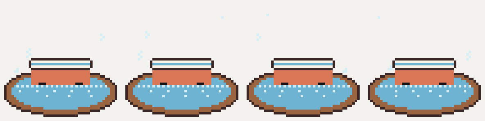

# Clawd Pet

A tiny pixel-art Clawd that lives in a small always-on-top window on your Windows desktop and reacts to what Claude Code is doing.



- **Onsen:** while Claude is idle, Clawd soaks in a hot spring with a towel on its head, eyes half closed, steam rising.
- **Gym:** while Claude Code is working, Clawd lifts dumbbells (with a drop of sweat).
- **Petting:** hover over Clawd or click it and it smiles, blushes and a little heart floats up.

It goes back to the onsen about 2.5 seconds after Claude finishes. If several Claude Code sessions are running, it stays at the gym until all of them are done.

[Leggi in italiano](README.it.md)

## How it works

Claude Code [hooks](https://code.claude.com/docs/en/hooks) send each event (prompt submitted, tool used, stop…) with `curl` to a small local server inside the app at `127.0.0.1:47321`. The app only reads the event name and session id, and only on your own PC. The hooks run in the background, so Claude never waits for the pet, and if the pet is closed they fail silently.

Regular Claude chat doesn't use hooks, so there Clawd just stays in the onsen.

## Quick start

Requires Windows 10/11 and Node.js 20+.

```powershell
npm install
npm run install-hooks   # adds the hooks to %USERPROFILE%\.claude\settings.json (makes a backup first)
npm start
```

Open a **new** Claude Code session after installing the hooks.

To build a standalone app: `npm run dist` creates `dist\win-unpacked\PetClaudeSpa.exe` (starts instantly) and a single-file `dist\PetClaudeSpa.exe` (unpacks itself, takes 20–30 s to appear).

## Usage

- Drag Clawd anywhere with the left mouse button.
- Quit from the tray icon near the clock: right-click, then **Esci**.
- Remove the hooks with `npm run uninstall-hooks`.
- Start it with Windows: put a shortcut to `dist\win-unpacked\PetClaudeSpa.exe` in `shell:startup` (press `Win+R`, type `shell:startup`). Delete the shortcut to turn it off.

## Development

```powershell
npm test
```

The sprites are drawn in code as 48×48 pixel grids (`src/renderer/sprites.js`) and scaled 3× with no smoothing.
